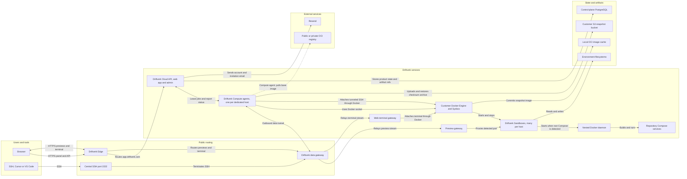

# Driftverk hybrid architecture

This document names the components in the current hybrid pilot and shows how traffic, compute jobs, environments, and snapshots move through the system.

The hybrid pilot supports one or more customer-owned compute hosts per customer organization. Each host runs one Driftverk Compute agent stack and many Driftverk Sandboxes. The customer owns the hosts and S3 bucket. Driftverk operates Driftverk Cloud.

The live control plane runs as a Docker Compose project behind Dokploy Traefik. The current internal compute test also runs on that VPS with the standard `runc` runtime. This proves the control-plane and Compute agent flow, but it is not the intended customer isolation boundary. Production customer compute should run on a separate compatible host with Sysbox.

## Hybrid compute model

## Component names

| Name | Runs where | Purpose |
| --- | --- | --- |
| Driftverk website | Driftverk | Public product, documentation and sales site. It is separate from the authenticated platform. |
| Driftverk Cloud | Driftverk | Login, platform admin, organizations, environment and snapshot records, job queue, authorization and customer UI. |
| Driftverk data gateway | Driftverk | Holds authenticated outbound Compute agent connections, terminates product SSH, and routes preview, terminal, and SSH streams to the assigned compute node. |
| PostgreSQL | Driftverk | Stores product state, job leases, assigned compute node, runtime ID and snapshot artifact references. |
| Resend | External | Delivers account verification, password reset and organization invitation email from the verified `driftverk.com` domain. |
| Compute host | Customer | Dedicated Linux machine that owns Docker and runs customer environments. |
| Driftverk Compute agent | Customer compute host | Authenticates with an organization-bound token, reports CPU/RAM capacity, polls for jobs and manages environments through the local Docker socket. Organizations may connect several hosts, each with its own identity. |
| Docker Engine and Sysbox | Customer compute host | Runs the isolated system containers. `sysbox-runc` is the intended production runtime. |
| Driftverk Sandbox | Customer compute host | One isolated development container. Many Sandboxes can run on one host. |
| Nested Docker and Compose | Driftverk Sandbox | Starts a repository's root Compose project without exposing the compute host Docker socket. An explicit startup command takes precedence. |
| `driftverk-edge` | Customer compute host | Internal Docker network shared by the Compute agent stack. It does not require a public reverse proxy on a hybrid host. |
| `driftverk-sandboxes` | Customer compute host | Private Docker network used to reach listening ports inside Driftverk Sandboxes. |
| Preview gateway | Customer compute host | Resolves an authorized preview and proxies HTTP or WebSocket traffic to a detected environment port. |
| Web terminal gateway | Customer compute host | Exchanges an authorized terminal ticket for a Docker terminal attached to the local environment. |
| Local OCI image cache | Customer compute host | Holds pulled base images and recently created or restored snapshot images. It is not durable storage. |
| Customer S3 bucket | Customer account | Stores compressed OCI snapshot archives. The control plane stores the object reference and SHA-256 checksum, not the bucket credentials. |
| OCI registry | External or customer-owned | Supplies clean base images for new environments. It is separate from captured snapshots. |

## Environment lifecycle

1. The user creates an environment in the control plane.
2. Driftverk Cloud writes the environment and a queued job to PostgreSQL.
3. The organization-bound Driftverk Compute agent polls over HTTPS and leases the job.
4. The Compute agent pulls the OCI image or restores a snapshot from S3.
5. Docker creates and starts the environment with Sysbox.
6. For a repository with a standard root Compose file and no explicit startup command, the Compute agent starts the nested Docker daemon and the complete Compose project inside the environment.
7. The compute agent reports the runtime ID, node ID, state, logs, ports, metrics and runtime activity.
8. The control plane records trusted activity timestamps and queues an automatic stop after the configured idle period.
9. Preview, terminal, and SSH requests enter through the central data gateway and use the assigned node's outbound tunnel.

## Snapshot lifecycle

1. Docker pauses the environment briefly and commits its writable filesystem as a local OCI image.
2. The compute agent exports and compresses the OCI image.
3. The compute agent calculates SHA-256 and uploads the archive to the customer's S3 prefix.
4. The control plane stores the S3 reference and checksum.
5. Restore downloads the archive, checks its reference, S3 metadata and SHA-256, then loads the OCI image into Docker.
6. Docker creates a new environment from the restored image.

Host-mounted volumes are outside the snapshot. Databases need their own application-consistent backup process.

## Multiple compute hosts

The model is one Compute agent stack on each compute host, with compatible customer hosts using the same customer S3 prefix when snapshots must move between them.

Organization-scoped credentials, explicit host selection, CPU/RAM admission checks, first-claim node affinity, and tunneled preview, terminal, and SSH routing are implemented. Claims serialize per Hybrid host and reserve resources transactionally. Automatic placement uses the next eligible polling host; this is not a rebalancer. Offline hosts retain ownership until they return. Local snapshots and volumes stay on their owning host; S3 snapshots can restore across compatible updated hosts. See HYBRID_INSTALL.md for storage compatibility and recovery limits.
